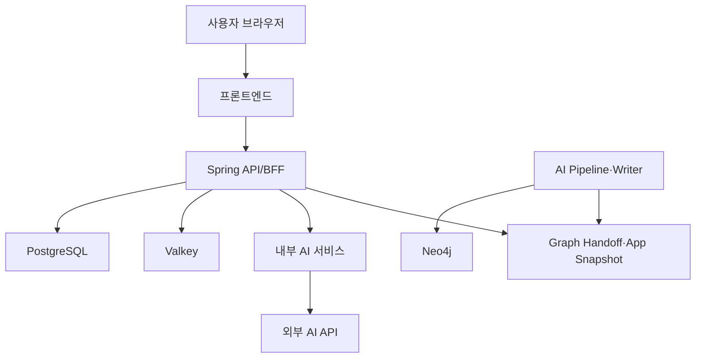

# ZOOP 시스템 구성

## 현재 상태

- 프론트엔드와 백엔드 애플리케이션 개발 진행 중
- Dev AWS 인프라 Terraform 구성 완료, 실제 배포 보류
- 관계형 DB: Amazon RDS for PostgreSQL
- 캐시: Amazon ElastiCache for Valkey
- GraphDB: Neo4j 5.26.32 Community
- Neo4j 실행 환경: Private Subnet의 EC2 및 Docker
- 실제 사용자 데이터 및 운영 트래픽 없음

## 논리 시스템 구성

## Neo4j 연결 경계

| 주체 | Neo4j 직접 연결 | Secret 사용 | 현재 상태 |
|---|---:|---:|---|
| Spring API/BFF | 안 함 | 안 함 | 확정 |
| 공개 Graph Handoff API | 안 함 | 안 함 | 확정 |
| AI Writer 운영자 | SSM 터널을 통해 연결 | 사용 | 준비 중 |
| AI `graph.read` API | 직접 연결 예정 | 활성화 시 사용 | 초기 비활성 |
| Neo4j EC2 부트스트랩 | 로컬 연결 | 사용 | Terraform 구성 |

Spring API/BFF는 AI Pipeline이 생성한 Graph Handoff 또는 App Snapshot을 읽으며 Neo4j에 직접 연결하지 않는다.

초기 Dev 환경에서는 Neo4j의 7474 및 7687 포트를 EC2의 localhost에만 바인딩한다. Writer 운영자는 AWS Systems Manager Session Manager 포트 포워딩을 통해 접근한다.

AI `graph.read` API를 활성화할 때는 별도 검토 후 최소 범위의 7687 보안 그룹 규칙과 Secret 권한을 추가한다.

## 구성요소 역할

| 구성요소 | 역할 |
|---|---|
| 프론트엔드 | 그래프·기업 상세·브리핑·챗봇 화면 |
| Spring API/BFF | 인증·사용자·종목·근거 및 App Snapshot 조회 |
| PostgreSQL | 회원·종목·원문·분석 결과·처리 상태 저장 |
| Valkey | 세션·캐시 및 임시 상태 처리 |
| Neo4j | 비공개 버전별 기업·산업·이슈 관계와 근거 ID 저장 |
| AI 서비스 | 이슈 추출·브리핑·근거 기반 답변 |
| AI Pipeline·Writer | AI 결과 생성 및 승인된 결과의 Neo4j 반영 |
| Graph Handoff·App Snapshot | 공개 API가 읽는 그래프 조회용 결과 |

## Neo4j Dev 기준

- 이미지: `neo4j:5.26.32`
- 데이터베이스: `neo4j`
- Store ID: `zoop-dev-graph`
- 최초 빈 DB 초기화: Graph Store 바인딩이 없을 때만 `preflight → init`
- 기존 환경 재실행: 최초 바인딩에 사용한 동일 stored URI·원장과 실제 database 값(Dev: `neo4j`)으로 멱등 `init`
- 바인딩 충돌: `graph_store_already_bound` 발생 시 접속을 거절하고 불일치 조사
- 데이터 보호: 기존 Neo4j 데이터와 Store ID를 초기화·삭제하거나 재바인딩하지 않음
- 데이터 볼륨: 암호화된 EBS gp3
- Public IP: 없음
- 운영 접속: AWS Systems Manager
- HTTP 7474: localhost 전용
- Bolt 7687: localhost 전용
- API/BFF 직접 접속: 금지
- AI 서비스 직접 접속: 초기 비활성

## 미확정 항목

- `bolt+s`용 인증서 발급 및 신뢰 배포 방식
- `neo4j.dev.zoop.internal` 내부 DNS 사용 여부
- SSM 터널 환경의 인증서 호스트명 검증 방식
- EBS 스냅샷 주기 및 보존 기간
- AI `graph.read` API 활성화 시점과 권한
- 운영 환경의 백업·복구 검증 기준

## 인프라 원칙

- DB와 내부 서비스 포트는 일반 사용자에게 공개하지 않는다.
- 비밀번호와 API 키는 코드 또는 문서에 기록하지 않는다.
- API/BFF에는 불필요한 Neo4j Secret과 네트워크 권한을 부여하지 않는다.
- Neo4j 데이터는 EC2 및 컨테이너 교체 후에도 EBS에 유지한다.
- 실제 배포 전에 TLS, 백업 및 복구 방식을 확정한다.
