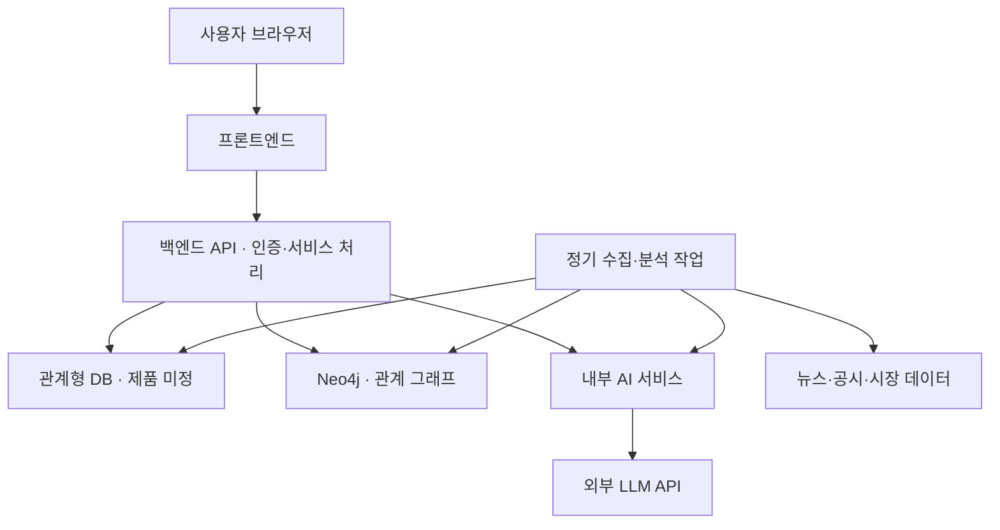

# ZOOP 시스템 구성도 초안

## 현재 상태

- GraphDB: Neo4j 사용 예정
- 관계형 DB: 미정
- 백엔드 기술·실행정보: 미정
- AI 최종 실행정보: 미정
- AWS 사용 신청 준비 중
- 실제 서버 구축·배포 전

## 논리 시스템 구성

## 구성요소 역할

| 구성요소 | 역할 |
|---|---|
| 프론트엔드 | 그래프·기업 상세·브리핑·챗봇 화면 |
| 백엔드 API | 인증·사용자·종목·관계·근거 조회 |
| 관계형 DB | 회원·종목·원문·분석 결과·처리 상태 저장 |
| Neo4j | 기업·산업·이슈 관계와 근거 ID 저장 |
| AI 서비스 | 이슈 추출·브리핑·근거 기반 답변 |
| 정기 작업 | 뉴스 수집·분석·브리핑 생성 실행 |

## 확인할 설계 사항

- 백엔드와 AI의 기술·배포 단위
- 관계형 DB 종류와 배포 방식
- Neo4j 버전·에디션·백업 방식
- 비회원에게 허용할 기능
- 정기 수집 주기와 브리핑 생성 시각
- 도메인·HTTPS·AWS 허용 자원

## 인프라 원칙

- DB와 내부 AI 포트는 일반 사용자에게 공개하지 않는다.
- 비밀번호와 API 키는 코드에 저장하지 않는다.
- DB 데이터는 컨테이너 교체 후에도 유지한다.
- 백업 생성과 실제 복원 검증을 진행한다.
